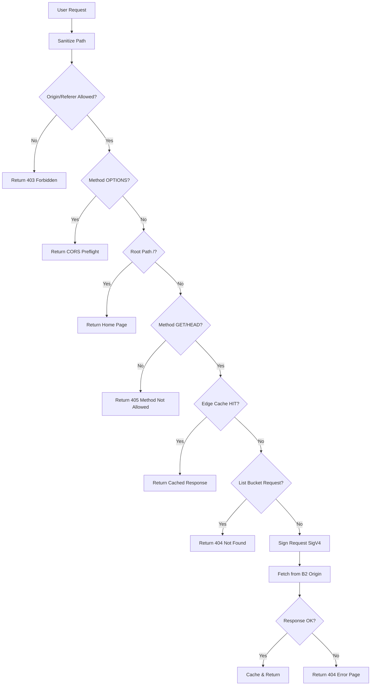
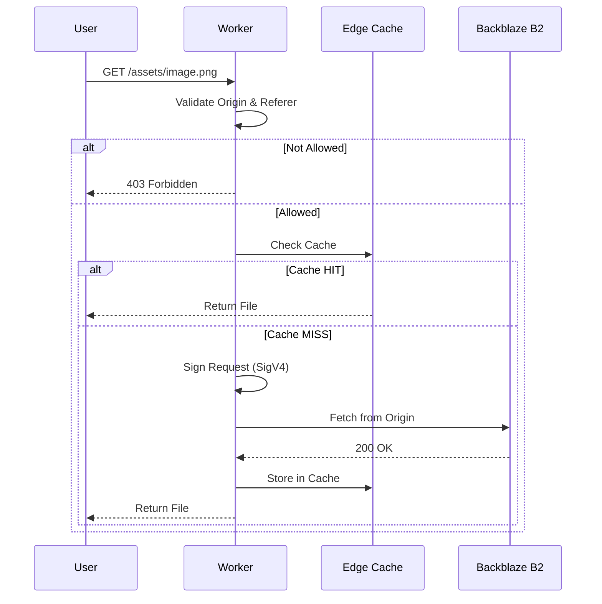

# Nanoo CDN Architecture

Edge proxy for private Backblaze B2 bucket via Cloudflare Workers.

## Request flow



## Sequence



## Project structure

```
src/
├── index.js          # Worker entrypoint, request routing, CORS, caching
└── lib/
    ├── signer.js     # AWS SigV4 signing via aws4fetch
    ├── cache.js      # Cloudflare Cache API wrapper
    ├── utils.js      # Path sanitization, header filtering
    └── home.js       # Inline HTML templates (home + error page)
public/
├── assets/
│   ├── nanoo.min.css   # Design system (@nlbs/css, vendored)
│   ├── cdn.css          # Page-specific layout + font-face
│   ├── icons.svg        # SVG sprite (sun/moon theme icons)
│   └── fonts/           # Geist Mono woff2
```
